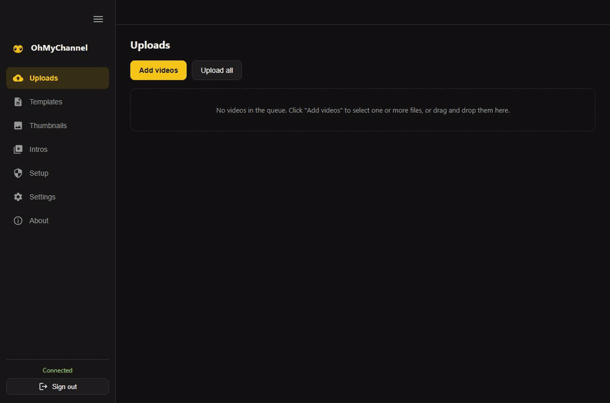

<div align="center">


# OhMyChannel

La app de escritorio que sube videos a YouTube con antelación.

[](https://github.com/gabrielSantosLima/OhMyChannel/releases)
[](https://github.com/gabrielSantosLima/OhMyChannel/actions/workflows/build.yml)
[](LICENSE)

[English](README.md) | [Português (Brasil)](README.pt-BR.md) | [Español](README.es.md)

<br />



</div>

OhMyChannel es una app de escritorio en Electron que sube videos a YouTube con
antelación. Solo completas el título y la descripción — la subida se ejecuta en
segundo plano con progreso en vivo en la bandeja del sistema y, al terminar, una
notificación te lleva directo a YouTube Studio para completar el resto.

## Características

- Inicia sesión con Google (OAuth) y sube videos a YouTube.
- Cola de varios videos — arrastra archivos a la ventana o usa "Add videos" — y
  súbelos a la vez, con progreso y cancelación por video.
- Completa solo el título y la descripción; el resto en YouTube Studio.
- Sigue subiendo en segundo plano con el progreso general en la bandeja; haz clic
  en la notificación de finalización para abrir YouTube Studio.
- Plantillas reutilizables de título/descripción con el comando `/template` y
  autocompletado. Al insertar una plantilla, cada parámetro se convierte en un
  chip editable en línea, permitiendo valores con espacios.
- Añade el video subido a una de tus listas de reproducción (la lista se obtiene
  de tu cuenta).
- Programa la fecha de publicación (el video permanece privado hasta la hora
  elegida).
- Define una miniatura personalizada eligiendo una imagen, arrastrándola al
  cuadro o generándola desde una plantilla de miniatura.
- Editor visual de miniaturas: imagen de fondo, elementos de texto e imagen,
  arrastrar para posicionar, menú contextual (clic derecho) para
  añadir/duplicar/reordenar/eliminar, parámetros dinámicos o estáticos y
  exportación a PNG.
- Intros: sube videos de intro, configura transiciones de video y audio por
  separado (none/fade/crossfade), ajusta el volumen de la intro y previsualiza el
  resultado con un marcador en lugar del video principal.
- Renderiza la intro junto con el video antes de subirlo, a una resolución
  configurable (por defecto 2K) y con la tasa de fotogramas del video principal.
  El render tiene su propia cola, con un número configurable de renders en
  paralelo y estado "Queued". Opcionalmente envía automáticamente tras renderizar
  o confirma manualmente.
- Pantalla de Setup que te guía para crear tus propias credenciales OAuth de
  Google Cloud e importarlas; no se incluye ninguna credencial en la app.
- Auto-actualización: la app busca nuevas versiones, las descarga en segundo
  plano y muestra un icono "Update" arriba para reiniciar e instalar.
- Navegación lateral con una pantalla de Settings (tema, ejecución en segundo
  plano, subidas/renders en paralelo, resolución de render y preferencias de
  actualización) y una pantalla About con la versión.

## Primeros pasos

```bash
npm install
npm start
```

OhMyChannel usa **tus** credenciales OAuth de Google Cloud. Abre la pantalla
**Setup** en la app para una guía paso a paso y haz clic en "Import credentials"
para añadir tu `client_secrets.json`. No se incluye ninguna credencial en la app.

## Plataformas

- **Windows**: instalador NSIS y build portable.
- **Linux**: AppImage y `.deb`.

La auto-actualización funciona en el instalador NSIS (Windows) y en el AppImage
(Linux). Las builds portable y `.deb` no se auto-actualizan; su icono de
actualización abre la página de la release para descargar la nueva versión
manualmente.

## Releases

Las releases se crean con la GitHub Action **manual** `Release`
(`.github/workflows/release.yml`, `workflow_dispatch`). Hace el bump de la versión
en `package.json`, genera las notas desde los Conventional Commits desde el
último tag (con referencias de commit), commitea `chore(release): v<version>`,
crea el tag `v<version>` y publica la GitHub Release.

Para generar las notas localmente:

```bash
node scripts/release-notes.js
```

### Generar instaladores

La GitHub Action **Build** (`.github/workflows/build.yml`) genera los instaladores
en una matriz (Windows + Linux) y los adjunta a la release. Se ejecuta
automáticamente después de una release y también puede lanzarse manualmente con
un tag (p. ej. `v0.0.1`). Los formatos están en la sección Plataformas.

Localmente usa `npm run dist:win` o `npm run dist:linux` en el SO correspondiente.
Las credenciales nunca se empaquetan: `client_secrets.json` y `token.json` se
excluyen del paquete.

## Licencia

Este proyecto está bajo la licencia MIT. Consulta el archivo [LICENSE](LICENSE)
para más detalles.
